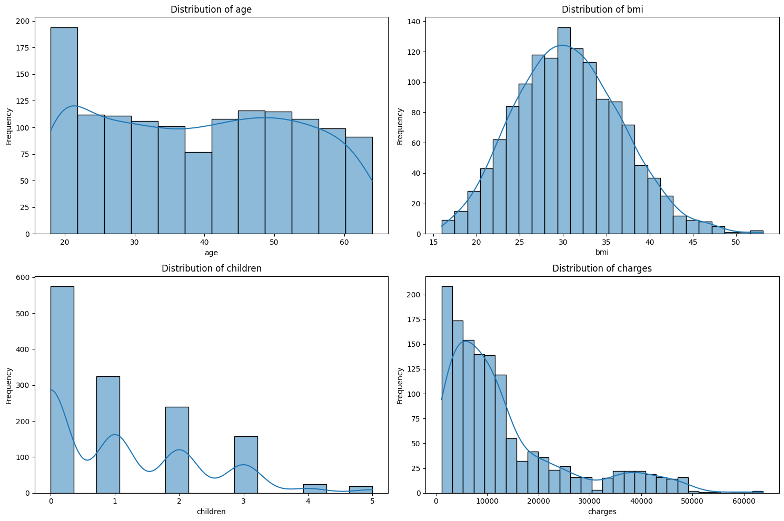
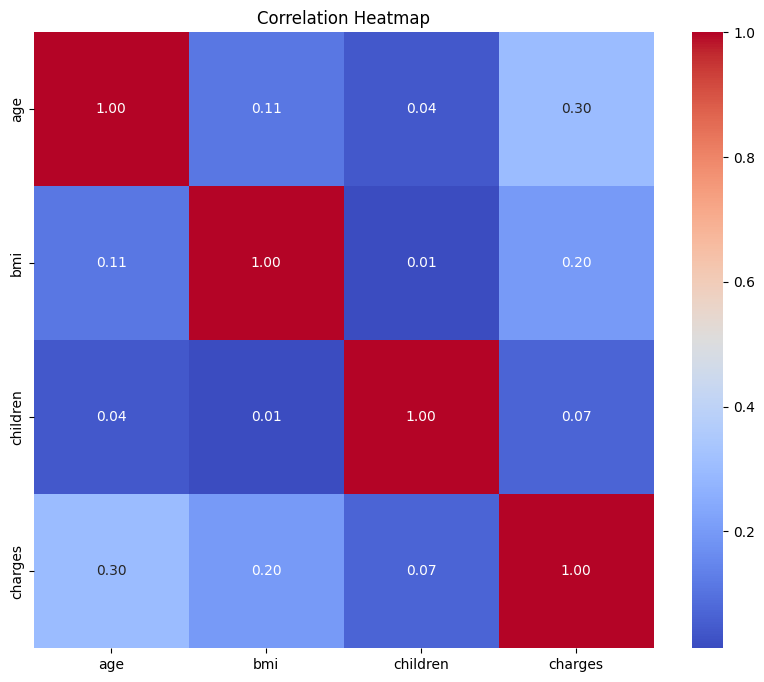
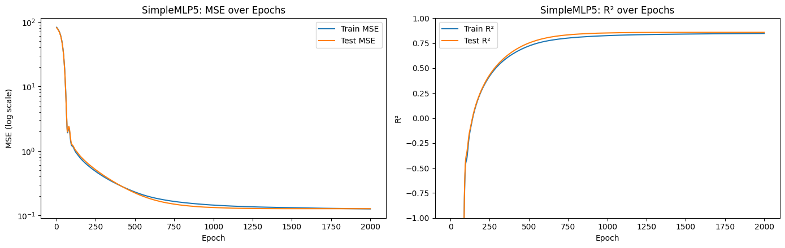
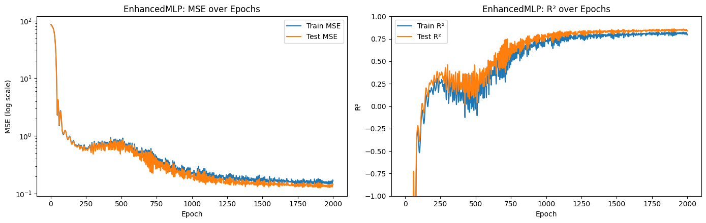
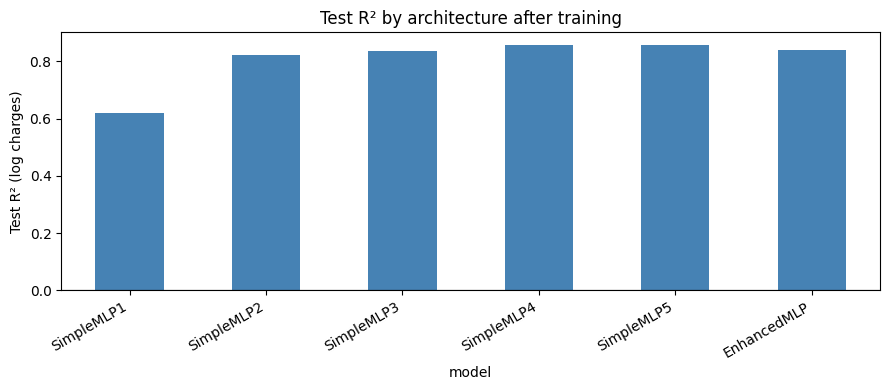
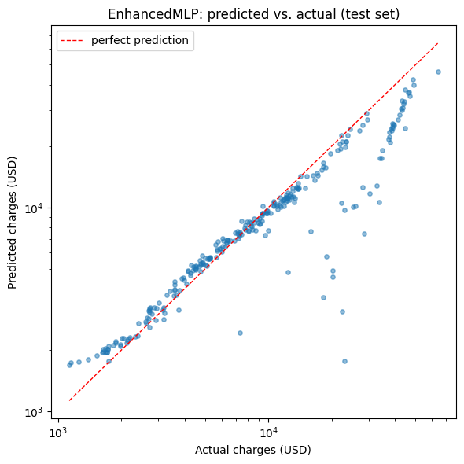

# Medical Insurance Charges Prediction with MLPs

Predicting individual medical insurance charges from demographic and lifestyle data with fully connected
neural networks in PyTorch, from exploratory data analysis to a reproducible model comparison.

[](https://github.com/<your-github-username>/insurance-charges-mlp/actions/workflows/notebook.yml)

- **Executed notebook (HTML):** published to GitHub Pages by the workflow at
  `https://<your-github-username>.github.io/insurance-charges-mlp/`
- **Results report (PDF):** [`outputs/insurance_charges_mlp_results.pdf`](outputs/insurance_charges_mlp_results.pdf)
- **Notebook:** [`notebooks/insurance_charges_mlp.ipynb`](notebooks/insurance_charges_mlp.ipynb)

---

## Table of contents

1. [Project overview](#project-overview)
2. [Approach](#approach)
3. [Model architectures](#model-architectures)
4. [Dataset](#dataset)
5. [Repository structure](#repository-structure)
6. [Installation](#installation)
7. [Running the project](#running-the-project)
8. [Results](#results)
9. [Reproducing and interpreting the results](#reproducing-and-interpreting-the-results)
10. [Continuous integration and GitHub Pages](#continuous-integration-and-github-pages)
11. [Limitations](#limitations)

---

## Project overview

### Problem definition

Health insurers need to estimate the medical costs a policyholder is likely to generate. Given six
attributes of a person (age, sex, BMI, number of children, smoking status and residential region),
the goal is to **predict the yearly medical charges billed by the insurer**. This is a supervised
**regression** problem on tabular data.

### Objectives

- Understand the data: distributions, correlations, outliers and class imbalance.
- Design a preprocessing pipeline that handles skewed targets and mixed categorical/numeric features
  without data leakage.
- Compare several multi-layer perceptron (MLP) designs (width, activation function, depth, dropout).
- Evaluate the final model both on the training scale (log charges) and in real dollars.

## Approach

1. **Exploratory data analysis**: summary statistics, histograms, boxplots, count plots and a
   correlation heatmap. The target `charges` is strongly right-skewed, and smokers are a minority class
   (274 of 1,338 records).
2. **Outlier analysis** using the 1.5 × IQR rule: 9 outliers in `bmi` and 139 in `charges`.
3. **Transformations**:
   - `charges` → `log(charges + 1)`, which removes all IQR outliers in the target.
   - `bmi` → Box-Cox transform, which reduces the BMI outliers from 9 to 4.
4. **Train/test split**: 80/20 (`random_state=42`, 1,070 training and 268 test rows).
5. **Encoding and scaling** with a scikit-learn `ColumnTransformer` fitted **on the training set only**:
   - `StandardScaler` for `age`, `bmi_box_cox` and `children`
   - `OneHotEncoder` for `sex`, `smoker` and `region` (11 input features in total)
6. **Training**: full-batch Adam (lr = 0.001) with an MSE loss on the log target for 2,000 epochs
   (one optimiser step per epoch), with fixed random seeds.
7. **Evaluation**: train/test MSE and R² for every epoch, a comparison table across models, and
   MAE / RMSE / R² in dollars for the final model.

## Model architectures

| Model | Hidden layers | Activation | Regularisation | Parameters |
|---|---|---|---|---|
| SimpleMLP1 | 12 | Sigmoid | none | 157 |
| SimpleMLP2 | 32 | Sigmoid | none | 417 |
| SimpleMLP3 | 64 | Sigmoid | none | 833 |
| SimpleMLP4 | 64 | ReLU | none | 833 |
| SimpleMLP5 | 64 → 64 | ReLU | none | 4,993 |
| EnhancedMLP | 64 → 64 → 64 | ReLU | Dropout 0.5 / 0.3 / 0.1 | 9,153 |

Every network ends in a single linear output neuron that predicts `log(charges + 1)`.

**Implementation details**

- Targets are reshaped to `(N, 1)` so that they match the network output. A `(N,)` target would be
  broadcast silently by `nn.MSELoss` into an `N × N` comparison.
- Metrics are computed with the model in `eval()` mode, so dropout is disabled during evaluation.
- `set_seed()` fixes the Python, NumPy and PyTorch seeds before each model is created, so repeated runs
  give identical numbers on the same platform.
- Data and output locations can be overridden with the `INSURANCE_DATA_PATH` and `OUTPUT_DIR`
  environment variables.

## Dataset

**Medical Cost Personal Dataset** (1,338 rows, 7 columns, about 55 KB), included in this repository as
[`data/insurance.csv`](data/insurance.csv).

| Column | Type | Description |
|---|---|---|
| `age` | int | Age of the primary beneficiary (18–64) |
| `sex` | categorical | `female` / `male` |
| `bmi` | float | Body mass index |
| `children` | int | Number of dependents covered (0–5) |
| `smoker` | categorical | `yes` / `no` |
| `region` | categorical | `northeast`, `northwest`, `southeast`, `southwest` (US) |
| `charges` | float | Individual medical costs billed by the insurer (**target**) |

- Source: Kaggle, <https://www.kaggle.com/datasets/mirichoi0218/insurance>
- The data originally comes from the book *Machine Learning with R* by Brett Lantz:
  <https://github.com/stedy/Machine-Learning-with-R-datasets>

Please check the Kaggle page for the dataset's license terms. If you prefer not to redistribute the file,
delete `data/insurance.csv`, download `insurance.csv` from either link above, and put it back in `data/`.
No other preparation is needed because all preprocessing happens inside the notebook.

## Repository structure

```text
insurance-charges-mlp/
├── .github/workflows/notebook.yml   # CI: execute notebook → index.html (Pages) + artifact
├── data/insurance.csv               # dataset (55 KB)
├── notebooks/
│   └── insurance_charges_mlp.ipynb  # full analysis, executed with outputs
├── outputs/
│   ├── figures/*.png                # plots extracted from the executed notebook
│   ├── metrics.json                 # final metrics of every model
│   └── insurance_charges_mlp_results.pdf
├── scripts/run_pipeline.py          # execute notebook, export HTML, figures and PDF
├── requirements.txt
└── README.md
```

Files generated locally but not committed: `site/index.html`, `build/` (executed copy of the notebook)
and `outputs/models/enhanced_mlp.pth` (trained weights).

## Installation

### Prerequisites

- Python **3.10–3.12** (tested with 3.11)
- `git`
- About 1 GB of free disk space for PyTorch. No GPU is needed; the whole notebook runs in about 20 seconds
  on a CPU.

### 1. Clone the repository

```bash
git clone https://github.com/<your-github-username>/insurance-charges-mlp.git
cd insurance-charges-mlp
```

### 2. Create and activate a virtual environment

macOS / Linux:

```bash
python3 -m venv .venv
source .venv/bin/activate
```

Windows (PowerShell):

```powershell
py -3.11 -m venv .venv
.venv\Scripts\Activate.ps1
```

Windows (Command Prompt):

```bat
py -3.11 -m venv .venv
.venv\Scripts\activate.bat
```

### 3. Install the dependencies

The CPU build of PyTorch is enough for this project. The extra index URL makes pip download the smaller
CPU-only wheel on Linux and Windows. This command is the same on every platform:

```bash
python -m pip install --upgrade pip
pip install -r requirements.txt --extra-index-url https://download.pytorch.org/whl/cpu
```

To open the notebook interactively, also install JupyterLab:

```bash
pip install jupyterlab
```

## Running the project

### Option A: run the whole pipeline (recommended)

From the repository root:

```bash
python scripts/run_pipeline.py
```

This command:

1. executes `notebooks/insurance_charges_mlp.ipynb` in a fresh kernel and saves the executed copy to
   `build/`;
2. exports it, with all outputs and plots, to **`site/index.html`**;
3. extracts the figures to `outputs/figures/`, and writes `outputs/metrics.json` and
   `outputs/insurance_charges_mlp_results.pdf`;
4. saves the trained EnhancedMLP weights to `outputs/models/enhanced_mlp.pth`.

Useful flags:

| Flag | Effect |
|---|---|
| `--inplace` | also write the outputs back into `notebooks/insurance_charges_mlp.ipynb` |
| `--no-execute` | only export the notebook as it is (no training) |
| `--timeout N` | per-cell timeout in seconds (default 1800) |

Open the result in a browser:

```bash
open site/index.html        # macOS
xdg-open site/index.html    # Linux
start site\index.html       # Windows
```

### Option B: run interactively in Jupyter

```bash
jupyter lab notebooks/insurance_charges_mlp.ipynb
```

Then select **Run → Run All Cells**. The notebook expects to be run from the `notebooks/` directory,
which is Jupyter's default, so the relative path `../data/insurance.csv` resolves correctly.

### Option C: plain nbconvert

```bash
jupyter nbconvert --to html --execute notebooks/insurance_charges_mlp.ipynb --output-dir site --output index
```

## Results

The numbers below come from a complete run of the notebook (CPU, Python 3.11, seed 42, 2,000 full-batch
epochs per model). They are stored in [`outputs/metrics.json`](outputs/metrics.json).

### Model comparison (target: `log(charges + 1)`)

| Model | Train MSE | Test MSE | Train R² | Test R² |
|---|---:|---:|---:|---:|
| SimpleMLP1 (12, sigmoid) | 0.3625 | 0.3428 | 0.563 | 0.619 |
| SimpleMLP2 (32, sigmoid) | 0.1789 | 0.1601 | 0.784 | 0.822 |
| SimpleMLP3 (64, sigmoid) | 0.1652 | 0.1457 | 0.801 | 0.838 |
| SimpleMLP4 (64, ReLU) | 0.1378 | 0.1297 | 0.834 | 0.856 |
| **SimpleMLP5 (64→64, ReLU)** | **0.1262** | **0.1271** | **0.848** | **0.859** |
| EnhancedMLP (3×64, ReLU + dropout) | 0.1656 | 0.1430 | 0.800 | 0.841 |

### EnhancedMLP in dollars (test set, 268 policyholders)

| MAE | RMSE | R² (USD) | R² (log) |
|---:|---:|---:|---:|
| $3,078 | $6,210 | 0.752 | 0.841 |

### Visualizations

| Feature distributions | Correlation heatmap |
|---|---|
|  |  |

**Training curves of the best model (SimpleMLP5) and of EnhancedMLP**




| Test R² by architecture | Predicted vs. actual charges (EnhancedMLP) |
|---|---|
|  |  |

All 12 figures are in [`outputs/figures/`](outputs/figures) and in the PDF report.

## Reproducing and interpreting the results

1. Follow the [installation](#installation) steps.
2. Run `python scripts/run_pipeline.py`.
3. Compare `outputs/metrics.json` with the tables above. With the same library versions on the same platform
   the numbers are identical. Other CPU architectures or PyTorch builds can change the last decimals,
   because floating-point operations are ordered differently.

**How to read the metrics**

- **MSE / R² on the log target** are what the networks optimise. R² = 1 is a perfect fit and R² = 0 is
  no better than always predicting the mean.
- **Width and activation matter.** Wider sigmoid networks fit better (R² 0.62 → 0.82 → 0.84), and ReLU
  beats sigmoid at the same width.
- **Depth helps, heavy dropout does not.** The two-layer ReLU network (SimpleMLP5) is the best model.
  EnhancedMLP generalises well but its dropout slows learning on this small, low-dimensional dataset
  without improving test performance.
- **No overfitting.** Train and test curves overlap for every model. The test R² is slightly higher than
  the train R² for this particular split.
- **Dollar-scale errors.** Most test points lie close to the diagonal of the predicted-vs-actual plot,
  but a group of high-cost policyholders (about $20k–$50k) is clearly underestimated. These large errors
  in dollars are why the dollar-scale R² (0.75) is lower than the log-scale R² (0.84), and why the RMSE
  ($6,210) is about twice the MAE ($3,078).

## Continuous integration and GitHub Pages

The workflow [`.github/workflows/notebook.yml`](.github/workflows/notebook.yml) runs on every push to
`main`, on pull requests and on manual dispatch. It:

1. sets up Python 3.11 and installs `requirements.txt` with CPU-only PyTorch;
2. runs `python scripts/run_pipeline.py`, which executes the notebook from scratch using the dataset in
   `data/` (no secrets or downloads needed);
3. uploads `site/index.html`, the executed notebook and `outputs/` as a downloadable workflow artifact
   named **`notebook-results`**;
4. on `main`, deploys `site/index.html` to **GitHub Pages**.

**One-time setup:** in the GitHub repository, open **Settings → Pages** and set **Source** to
**GitHub Actions**. The site will then be served at
`https://<your-github-username>.github.io/insurance-charges-mlp/`.

## Limitations

- The dataset is small (1,338 rows) and US-specific, so the models are not meant for real underwriting.
- Training is full-batch with a fixed number of epochs. There is no validation-based early stopping or
  hyperparameter search, and SimpleMLP1 is still improving at epoch 2,000.
- Metrics come from a single 80/20 split. Cross-validation would give more reliable estimates.
- High-cost policyholders are systematically underestimated (see the predicted-vs-actual plot).

## Author

Kiana Hashemi
